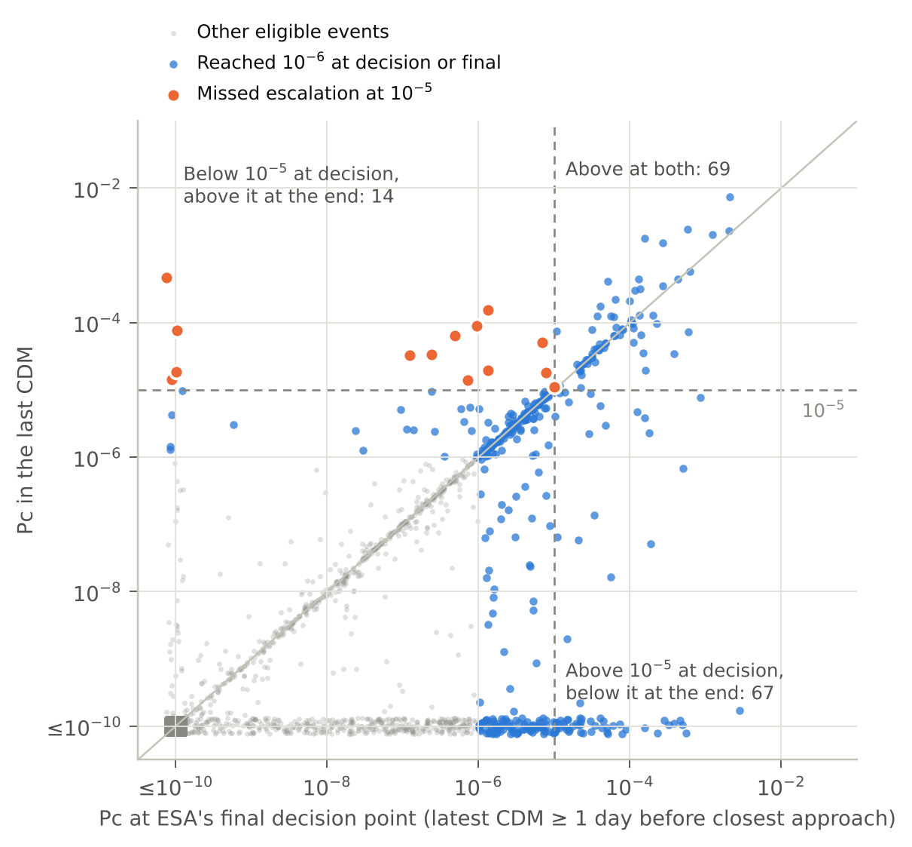
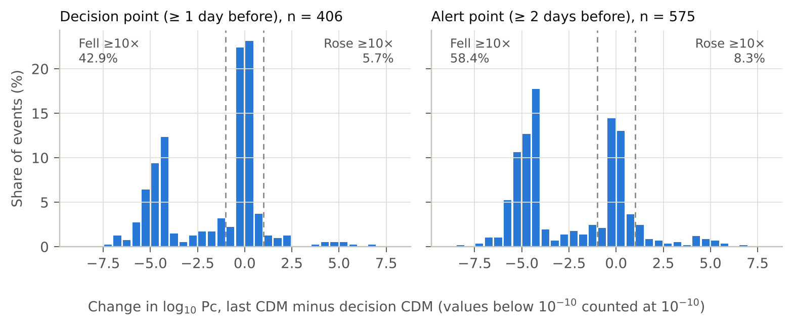
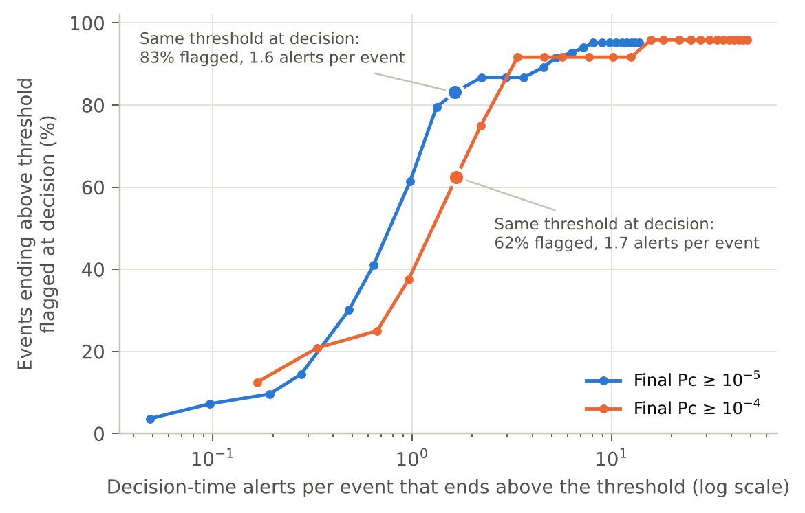
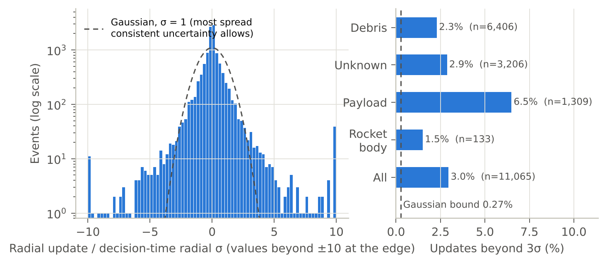
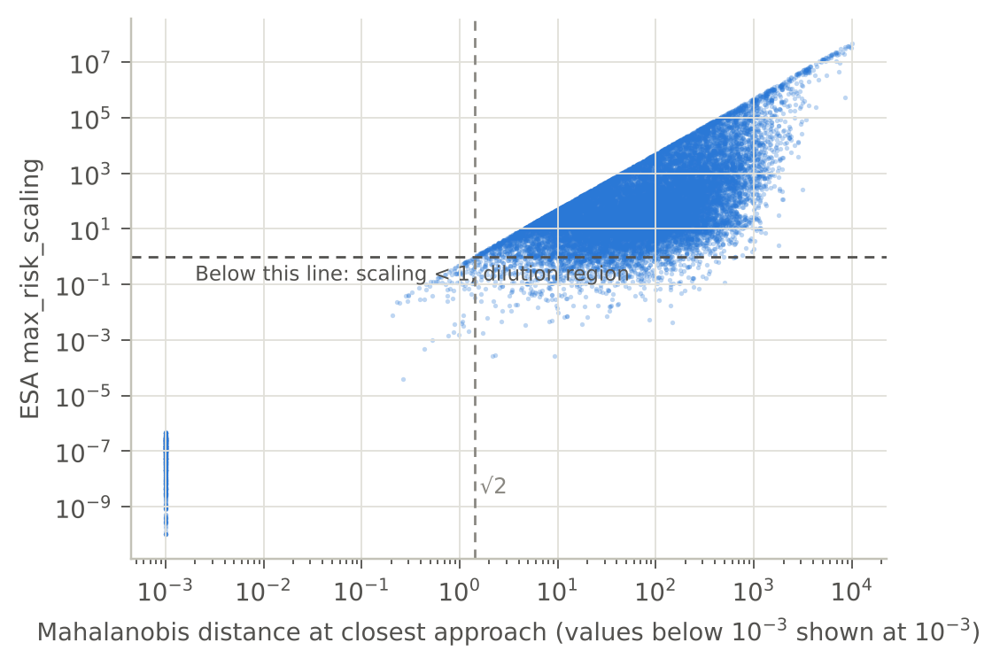

# Findings

What the analysis found, in plain terms. Every number below comes from `results/results.json`, produced by `scripts/run_audit.py`. Analyses that were not in [PLAN.md](PLAN.md) are marked **exploratory**. Where a prediction in the plan failed, this file says so.

## Data used

- 199,082 CDMs in 15,321 events across 19 missions, 2015 to 2019.
- 14,756 events have a CDM at least 1 day before closest approach (ESA's final decision point). 11,065 of those also have a later CDM, which makes them **eligible**.
- 406 eligible events reached Pc of 1e-6 or more at the decision point or in the last CDM. These are the **consequential** events.

## 1. Pc moves a lot in the final day (H1: supported)

Among consequential events, Pc changed by a factor of 10 or more between the decision CDM and the last CDM in **48.5%** of cases. The 95% CI is 43.6% to 53.2% resampling events, and 40.8% to 58.2% resampling missions. In **41.4%** of cases it changed by a factor of 100 or more.

The movement is mostly downward: 42.9% of events fell by 10× or more, and 5.7% rose by 10× or more.

Measured from the 2-day alert point instead, 66.8% changed by 10× or more.

The result is unchanged when CDMs issued after closest approach are excluded (47.5%).

*Figure 1. Pc at ESA's final decision point against Pc in the last CDM, for the 11,065 eligible events. Values below 1e-10 are shown at 1e-10, with a small jitter. The dashed lines mark 1e-5. Orange points were below 1e-5 at the decision point and ended at or above it.*

*Figure 2. Change in log10 Pc for consequential events. The cluster near −4 to −5 is made of events whose final Pc fell below 1e-10. Those are counted at the 1e-10 floor, so their true drop is larger than shown.*

## 2. A fixed threshold applied at decision time errs in both directions (H2)

| Threshold | Events ending at or above it | Flagged at decision | Missed at decision | Decision-time alerts | Alerts that ended below it |
|---|---|---|---|---|---|
| 1e-4 | 24 | 15 (62.5%) | 9 (37.5%) | 40 | 25 (62.5%) |
| 1e-5 | 83 | 69 (83.1%) | 14 (16.9%, CI 9.6% to 25.3%) | 136 | 67 (49.3%, CI 41.2% to 57.4%) |
| 1e-6 | 236 | 207 (87.7%) | 29 (12.3%) | 377 | 170 (45.1%) |

At 1e-5, about half of the decision-time alerts resolved below the threshold. About one in six of the events that ended above it had been below it at the decision point.

**Exploratory.** To flag 95% of the events that end at or above 1e-5, a decision-time rule would need a threshold of 1e-7. That produces 672 alerts, or 8.1 alerts per event that ends above 1e-5. Four of those 83 events had a decision-time Pc below 1e-9, the lowest at about 1.6e-27, so no threshold in the tested range catches them.

*Figure 3. The trade-off a decision-time threshold makes. Each point is one decision threshold, from 1e-3 down to 1e-9. The highlighted point uses the same threshold at decision as at the end.*

## 3. Probability dilution is real but explains a minority of misses (H3: partially supported)

The convention check passed. CDMs with `max_risk_scaling` below 1 have a median Mahalanobis distance of 3.6, against 82 for those above 1. Every CDM with a Mahalanobis distance below √2 has a scaling below 1 (Figure S1).

**5.0%** of decision CDMs sit in the dilution region (95% CI 4.6% to 5.5%). In those cases, a low Pc reflects large uncertainty rather than a wide miss.

Share of missed escalations whose decision CDM was in the dilution region:

| Threshold | Missed escalations in dilution region | Events that stayed below | Exploratory: stayed below, decision log10 Pc ≥ −10 |
|---|---|---|---|
| 1e-4 | 3 of 9 (33%) | 5.0% | 16.4% |
| 1e-5 | 2 of 14 (14%) | 4.7% | 15.1% |
| 1e-6 | 9 of 29 (31%) | 4.1% | 11.1% |

Missed escalations are more often dilution cases than the planned comparison group, but **most missed escalations are not dilution cases**. The prediction that misses would be "concentrated" in the dilution region is only partly supported.

There is also little hidden headroom. Among dilution-region decision CDMs below the threshold, ESA's maximum attainable Pc reached the threshold in only 1.5% (1e-4), 3.5% (1e-5) and 9.4% (1e-6) of cases.

## 4. The reported uncertainty fails in the tails (H4: supported in the tails)

As planned: the radial update from the decision CDM to the last CDM, divided by the decision-time combined radial sigma. **3.0%** of updates exceed 3σ (95% CI 2.6% to 3.3%; mission-level 1.8% to 4.6%). Consistent Gaussian uncertainty allows at most 0.27%, so this is roughly 11 times the bound. The standard deviation is 4.4, driven by outliers, while the robust spread is 0.38: most updates are small.

By chaser type, the share beyond 3σ is 6.5% for payloads, 2.9% for unknown objects, 2.3% for debris and 1.5% for rocket bodies.

**Exploratory.** Dividing instead by the uncertainty the update should remove, sqrt(σ²_decision − σ²_final), is defined for the 77% of events where the uncertainty shrank. On that measure the bulk is consistent (robust spread 1.11), but 8.1% of updates exceed 3σ (about 30 times the Gaussian rate) and 3.0% exceed 5σ.

*Figure 4. Left: radial updates in units of the decision-time radial sigma, on a log scale, against a unit Gaussian. Values beyond ±10 are shown at the edges. Right: share of updates beyond 3σ by chaser type.*

## 5. Smaller objects are not worse; active satellites are (H5: not supported)

By radar cross-section tercile (small, medium, large):

- Share changing by 10× or more: 55.0%, 45.8%, 75.7%.
- Share in the dilution region: 2.5%, 2.3%, 11.3%.
- Share of updates beyond 3σ: 2.7%, 1.7%, 4.4%.

The planned expectation that small objects would fare worst does not hold. The largest objects fare worst, and payload chasers, which can maneuver, have the largest share of dilution-region CDMs (19.9%) and the heaviest tails.

## 6. This archive cannot check Pc against outcomes (D1)

The final Pc values of all 15,321 events add up to **0.049 expected collisions**. No collision is the expected outcome whether or not Pc is calibrated, so an outcome-based check of Pc is impossible at the scale of one operator's archive. It would need pooled data from many operators, or a different outcome measure, such as the realized miss distance from tracking after the event.

## What this analysis cannot show

- There are no collision outcomes in the data. The last CDM is ESA's best estimate, not the truth.
- Objects too small to track never appear, so Pc's largest blind spot cannot be measured here.
- The missions are uncrewed ESA and partner spacecraft from 2015 to 2019.
- Anonymization removes absolute times and full states, which limits geometric reconstruction.
- Results differ across missions. For the five largest missions, the share of consequential events changing by 10× or more ranges from 35% to 82%. The mission-level intervals above account for this.

*Figure S1. Convention check for H3: ESA's `max_risk_scaling` against Mahalanobis distance for a random sample of 20,000 CDMs.*
