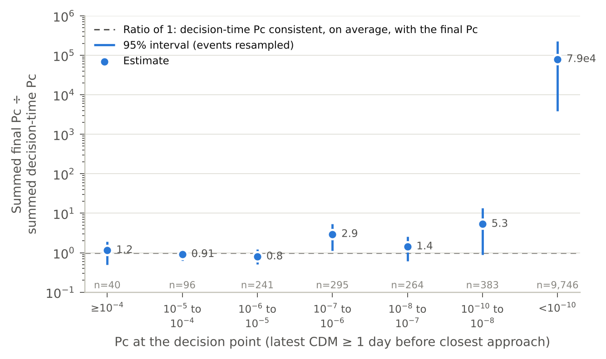

# Findings

What the analysis found, in plain terms. Every number below comes from `results/results.json`, produced by `scripts/run_audit.py`.

- Analyses that were not in [PLAN.md](PLAN.md) are marked **exploratory**.
- Analyses added after an independent review of the first write-up (run in a separate Claude session; not a peer review) are marked **exploratory, added after review**.
- Where a prediction in the plan failed, this file says so.

## Data used

- 199,082 CDMs in 15,321 events across 19 missions, 2015 to 2019.
- 14,756 events have a CDM at least 1 day before closest approach, the latest point at which ESA describes taking manoeuvre decisions. 11,065 of those also have a later CDM, which makes them **eligible**.
- 406 eligible events reached Pc of 1e-6 or more at the decision point or in the last CDM. These are the **consequential** events.

ESA prepared the archive with some filters ([Uriot et al.](https://doi.org/10.1007/s42064-021-0101-5)):

- Only events with a maximum attainable Pc above 1e-15 were kept.
- Intra-constellation and anomalous events were removed.
- Events that had already required an avoidance manoeuvre were removed. For events spanning a manoeuvre, CDMs before the manoeuvre epoch were removed.

**The archive therefore describes events where ESA did not end up manoeuvring.** That matters most for section 2 below.

## 1. Pc moves a lot in the final day, mostly downward (H1: as predicted)

Among consequential events, Pc changed by a factor of 10 or more between the decision CDM and the last CDM in **48.5%** of cases. The 95% CI is 43.6% to 53.2% resampling events, and 40.8% to 58.2% resampling missions. In 41.4% of cases it changed by a factor of 100 or more.

Most of the movement is downward: 42.9% of events fell by 10× or more, and 5.7% rose by 10× or more.

Measured from the 2-day point instead, 66.8% changed by 10× or more. Excluding CDMs issued after closest approach leaves the result essentially unchanged (47.5%).

**Movement on its own is not a defect.** A well-calibrated forecast is expected to move as uncertainty shrinks, and to fall for most events. Section 2 tests whether the movement is consistent with a calibrated forecast.

*Figure 1. Pc at the decision point against Pc in the last CDM, for the 11,065 eligible events. Values below 1e-10 are shown at 1e-10, with a small jitter. The dashed lines mark 1e-5. Orange points were below 1e-5 at the decision point and ended at or above it.*

*Figure 2. Change in log10 Pc for consequential events. The cluster near −4 to −5 is made of events whose final Pc fell below 1e-10. They are counted at the 1e-10 floor, so their true drop is larger than shown.*

## 2. High Pc values hold up on average; low ones understate later risk (exploratory, added after review)

Suppose each Pc were the probability of collision given the information available when it was computed. Then, for events grouped by their decision-time Pc, the later estimates should on average equal the earlier ones. The ratio of summed final Pc to summed decision-time Pc should therefore be close to 1. This test needs no collision outcomes.

| Decision-time Pc | Events | Ratio | 95% CI (events resampled) |
|---|---|---|---|
| 1e-4 or more | 40 | 1.15 | 0.50 to 1.92 |
| 1e-5 to 1e-4 | 96 | 0.91 | 0.63 to 1.26 |
| 1e-6 to 1e-5 | 241 | 0.80 | 0.51 to 1.23 |
| 1e-7 to 1e-6 | 295 | 2.94 | 1.14 to 5.36 |
| 1e-8 to 1e-7 | 264 | 1.43 | 0.61 to 2.57 |
| 1e-10 to 1e-8 | 383 | 5.32 | 0.89 to 13.4 |
| below 1e-10 | 9,746 | about 79,000 | 3,800 to 229,000 |
| **pooled, 1e-6 or more** | **377** | **1.11** | **0.55 to 1.73** |
| **pooled, below 1e-6** | **10,688** | **7.8** | **2.2 to 17.5** |

At 1e-6 and above, the decision-time Pc is consistent on average with the later estimates.

Below 1e-6, the later estimates assign about **eight times** the total risk the decision-time values stated. The extreme ratio in the lowest bin comes from four events that looked negligible a day out and ended above 1e-5.

Mission-level intervals are similar. From the 2-day point, the pooled ratios are 0.62 (0.23 to 1.54) and 5.7 (2.3 to 11.2).

This is the clearest sense in which a low Pc gives false comfort. **The scale is small, though.** The events below 1e-6 carry about 4% of the total final Pc of eligible events.

*Figure 5. Summed final Pc divided by summed decision-time Pc, by decade of decision-time Pc. A ratio of 1 means the decision-time values were consistent on average with the later estimates.*

## 3. A fixed threshold at decision time disagrees with the final classification in both directions (H2)

| Threshold | Events ending at or above it | Flagged at decision | Missed at decision | Decision-time alerts | Alerts that ended below it |
|---|---|---|---|---|---|
| 1e-4 | 24 | 15 (62.5%) | 9 (37.5%) | 40 | 25 (62.5%) |
| 1e-5 | 83 | 69 (83.1%) | 14 (16.9%) | 136 | 67 (49.3%) |
| 1e-6 | 236 | 207 (87.7%) | 29 (12.3%) | 377 | 170 (45.1%) |

Intervals at 1e-5:

- Missed share: 9.6% to 25.3% resampling events, 10.9% to 26.1% resampling missions.
- Alerts that ended below: 41.2% to 57.4% resampling events, 40.0% to 57.3% resampling missions.

**These shares describe events where ESA did not manoeuvre, not the error rates of a threshold rule in operations.** Events that required a manoeuvre are missing from the archive. That likely inflates the share of alerts that ended below the threshold.

A decision-time threshold at the same level flags about 1.6 events for each event that ends above it.

**Exploratory.** To flag 95% of the events that end at or above 1e-5, a decision-time rule would need a threshold of 1e-7. That produces 672 alerts, or 8.1 per event ending above 1e-5. Four of those 83 events had a decision-time Pc below 1e-12, the lowest at about 1.6e-27, so no threshold down to 1e-9 catches them.

*Figure 3. The trade-off a decision-time threshold makes. Each point is one decision threshold, from 1e-3 down to 1e-9 in quarter-decade steps. The highlighted point uses the same threshold at decision as at the end.*

## 4. Probability dilution is present in a minority of missed escalations (H3: not supported as stated)

The convention check passed. CDMs with `max_risk_scaling` below 1 have a median Mahalanobis distance of 3.6, against 82 for those above 1 (Figure S1).

At the decision point, **5.0%** of eligible events (95% CI 4.6% to 5.5%; mission-level 2.0% to 10.5%) and 8.2% of all decision CDMs sit in the dilution region.

Share of missed escalations whose decision CDM was in the dilution region:

| Threshold | Missed escalations in dilution region | Events that stayed below | Exploratory: stayed below, decision log10 Pc ≥ −10 |
|---|---|---|---|
| 1e-4 | 3 of 9 (33%) | 4.9% | 16.4% |
| 1e-5 | 2 of 14 (14%) | 4.7% | 15.1% |
| 1e-6 | 9 of 29 (31%) | 4.1% | 11.1% |

The plan predicted that missed escalations would be concentrated in the dilution region. **That prediction is not supported.** Dilution is present in a minority of missed escalations, and at 1e-5 not more often than among comparable events that stayed below the threshold.

Among dilution-region decision CDMs below a threshold, ESA's maximum attainable Pc reached the threshold in only 1.5% (1e-4), 3.5% (1e-5) and 9.4% (1e-6) of cases.

## 5. The reported uncertainty fails in the tails, but the tails do not explain the misses (H4: supported in the tails)

As planned: the radial update from the decision CDM to the last CDM, divided by the decision-time combined radial sigma. **3.0%** of updates exceed 3σ (95% CI 2.6% to 3.3%; mission-level 1.8% to 4.6%). Consistent Gaussian uncertainty allows at most 0.27%, so this is roughly 11 times the bound. The standard deviation is 4.4, driven by outliers, while the robust spread is 0.38.

Share beyond 3σ by chaser type, with mission-level intervals:

- Payloads: 6.5% (2.9% to 8.2%)
- Unknown objects: 2.9% (2.0% to 4.1%)
- Debris: 2.3% (1.6% to 3.4%)
- Rocket bodies: 1.5% (0% to 4.1%)
- TBA (n = 11): 9.1%

Mission 7 contributes 58% of the payload events. Without it, the payload share is 3.7%. The data do not record whether an object can manoeuvre, and the payload category includes defunct satellites.

**Exploratory, added after review: these tails do not explain most of the movement or the missed escalations.** Updates beyond 3σ occurred in:

- 15 of the 197 consequential events that moved by 10× or more;
- 2 of the 14 missed escalations at 1e-5;
- none of the 9 missed escalations at 1e-4.

Only the radial axis can be tested in the anonymized archive.

**Exploratory.** Dividing instead by the uncertainty the update should remove, sqrt(σ²_decision − σ²_final), is defined for the 77% of events where the uncertainty shrank. On that measure the bulk is consistent (robust spread 1.11), but 8.1% of updates exceed 3σ and 3.0% exceed 5σ.

*Figure 4. Left: radial updates in units of the decision-time radial sigma. The count axis is logarithmic, and values beyond ±10 are shown at the edges. The dashed curve is a unit Gaussian. Right: share of updates beyond 3σ by chaser type; TBA (n = 11) is not shown.*

## 6. Object size (H5: not supported, and confounded with object type)

By radar cross-section tercile over all objects (small, medium, large):

- Share changing by 10× or more: 55.0%, 45.8%, 75.7%.
- Share in the dilution region: 2.5%, 2.3%, 11.3%.
- Share of updates beyond 3σ: 2.7%, 1.7%, 4.4%.

These comparisons are confounded. The largest tercile holds almost all payloads, and objects of unknown type (29% of eligible events) have no radar cross-section.

**Exploratory, added after review.** Within debris only (cuts at 0.0097 and 0.014 m²), the three terciles show no clear difference in instability: 54.5%, 49.4% and 54.7% changed by 10× or more, each with intervals about ±10 points. The smallest tercile has a slightly higher share of updates beyond 3σ: 3.0% (2.3% to 3.7%) against 1.7% and 2.0%.

The planned expectation that small objects would fare worst on every measure is not supported.

## 7. This archive cannot check Pc against collisions (D1)

The final Pc values of all 15,321 events add up to **0.049 expected collisions**. If Pc were calibrated, the chance of seeing no collision would be about 95%. If Pc understated risk tenfold, it would still be about 61%. Seeing none is unsurprising either way.

Testing calibration against collisions would take pooled data from many operators, or a different outcome measure, such as the realized miss distance from tracking after each event. Section 2 shows that internal consistency between successive estimates can be tested without collisions.

## What this analysis cannot show

- **No ground truth.** There are no collision outcomes in the data. The last CDM is ESA's best estimate, not the truth.
- **Selection by ESA.** Events that required a manoeuvre were removed, so the threshold results describe events where ESA did not manoeuvre.
- **Untracked objects.** Objects too small to track never appear, so Pc's largest blind spot cannot be measured here.
- **Scope.** The missions are uncrewed ESA and partner spacecraft from 2015 to 2019.
- **Anonymization.** Absolute times and full states are removed, which confines the uncertainty test to the radial axis.
- **Mission differences.** Results differ across missions. For the five largest missions, the share of consequential events changing by 10× or more ranges from 35% to 82%. The mission-level intervals above account for this.

*Figure S1. Convention check for H3: ESA's `max_risk_scaling` against Mahalanobis distance for a random sample of 20,000 CDMs.*
